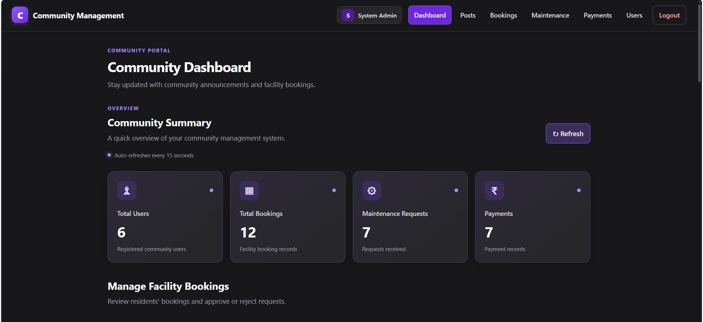
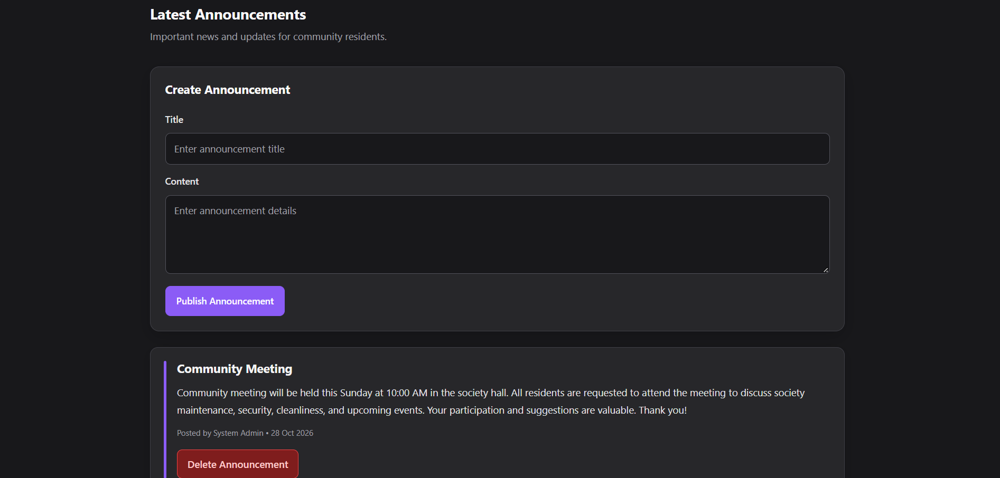
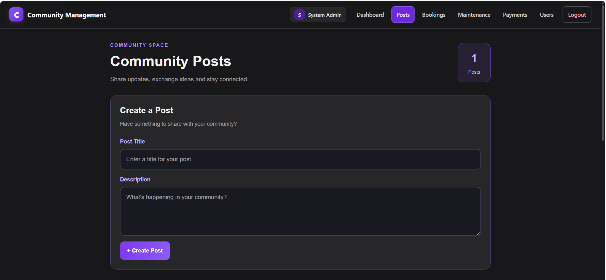
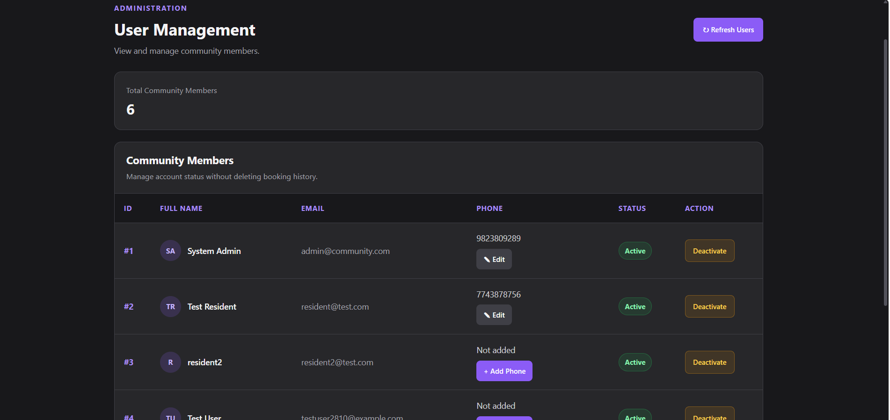
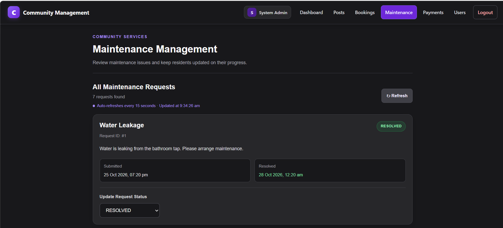
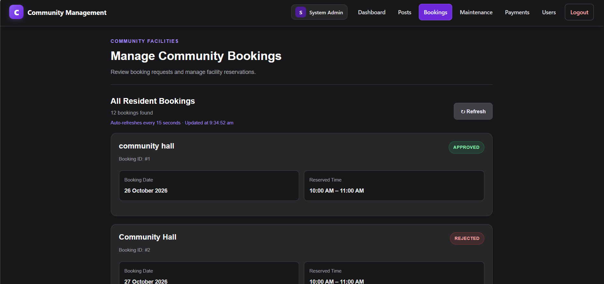
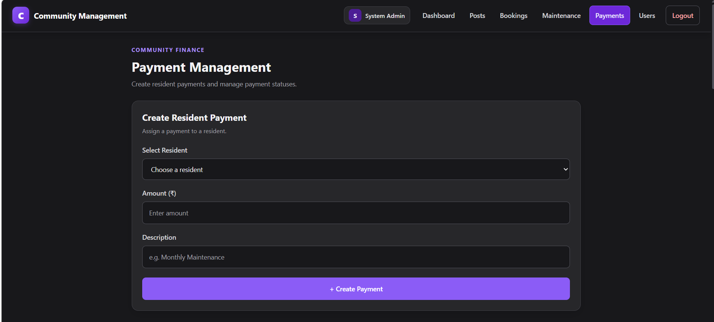

# Community Property Management System

A full-stack web application designed to simplify residential society management. The system provides role-based access for administrators, residents, and staff to manage community activities through a centralized platform.

## Features

- **Authentication & Authorization:** Login, JWT-based authentication, and role-based access control.
- **Dashboard & Announcements:** A centralized dashboard displaying community information and society announcements.
- **Community Posts:** Create posts, add comments, edit posts, and delete posts.
- **Maintenance Management:** Submit maintenance requests and manage maintenance operations.
- **Facility Bookings:** Create bookings, view booking details, and manage eligible booking cancellations.
- **Payment Records:** View and manage payment records through a demo payment module.
- **User Management:** Manage community users according to assigned permissions.
- **Auto-Refresh:** Selected pages periodically refresh their displayed data.

## Technology Stack

| Layer | Technologies |
|---|---|
| Frontend | React.js, JavaScript, HTML5, CSS3 |
| API Communication | Axios, REST APIs |
| Backend | Java, Spring Boot |
| Security | Spring Security, JWT |
| Persistence | Spring Data JPA, Hibernate |
| Database | MySQL |
| Build Tool | Maven |
| Development Tools | IntelliJ IDEA, Visual Studio Code |

## Project Architecture

The application follows a client-server architecture.

1. The React frontend provides the user interface.
2. Axios communicates with the backend REST APIs.
3. Spring Boot handles business logic and API requests.
4. Spring Security and JWT support authentication and authorization.
5. Spring Data JPA and Hibernate connect the backend to MySQL.

## Project Structure

```text
community-property-management-system/
├── backend/
│   ├── pom.xml
│   └── src/
│       └── main/
│           ├── java/
│           └── resources/
│               └── application.yml
├── frontend/
│   ├── package.json
│   ├── public/
│   └── src/
├── screenshots/
│   ├── dashboard.png
│   ├── announcement.png
│   ├── posts.png
│   ├── users.png
│   ├── maintenance.png
│   ├── bookings.png
│   └── payments.png
└── README.md
```

## Prerequisites

Install the following software before running the application:

- Java JDK compatible with the project configuration
- Maven
- MySQL Server
- Node.js and npm
- IntelliJ IDEA or another Java IDE
- Visual Studio Code or another frontend editor

## Setup and Installation

### 1. Clone the Repository

```bash
git clone https://github.com/Samruddhi317/community-property-management-system.git
cd community-property-management-system
```

### 2. Configure the Database

Create the MySQL database:

```sql
CREATE DATABASE community_db;
```

Configure your MySQL username and password using the environment variables expected by the backend configuration.

Ensure that the database connection settings in `backend/src/main/resources/application.yml` match your local environment.

**Security note:** Never commit database passwords, JWT secrets, or other sensitive credentials to a public repository.

### 3. Run the Backend

1. Open the `backend` folder in IntelliJ IDEA.
2. Configure the required environment variables.
3. Ensure that MySQL is running.
4. Run the Spring Boot application.

Backend URL:

`http://localhost:8081`

API base URL:

`http://localhost:8081/api`

### 4. Run the Frontend

Open the `frontend` folder in Visual Studio Code and run:

```bash
npm install
npm start
```

Open the application in your browser:

`http://localhost:3000`

Ensure that the frontend API configuration points to the running backend.

## User Roles

| Role | Responsibilities |
|---|---|
| Admin | Manage users, announcements, bookings, and relevant community operations |
| Resident | View announcements, create posts, submit maintenance requests, book facilities, and access available payment records |
| Staff | Access and manage assigned maintenance operations according to permissions |

Available operations depend on the application's configured authorization rules.

## Security

- JWT-based authentication.
- Role-based access control.
- Protected backend endpoints.
- Environment-based configuration for credentials and secrets.
- Database credentials and JWT secrets should never be committed to a public repository.

## Screenshots

### Dashboard — Community Overview

The main dashboard provides an overview of the community and its information.



### Dashboard — Announcements View

Announcements are displayed within the same Dashboard page. This screenshot shows the announcements section of the dashboard, not a separate page.



### Community Posts

Create posts, participate in discussions, add comments, and manage posts.



### User Management

Manage community users according to their roles and permissions.



### Maintenance Management

Submit maintenance requests and manage maintenance-related operations.



### Facility Bookings

Create and view facility bookings and manage eligible booking actions.



### Payment Records

View payment records through the application's demo payment module.



## Future Enhancements

- Integration with a real payment gateway.
- Email and notification services.
- Cloud deployment.
- Automated unit and integration testing.
- Enhanced reports and analytics.

## Author

**Samruddhi Karale**

BE — Artificial Intelligence and Data Science

## License

This project was developed for educational and academic purposes.
